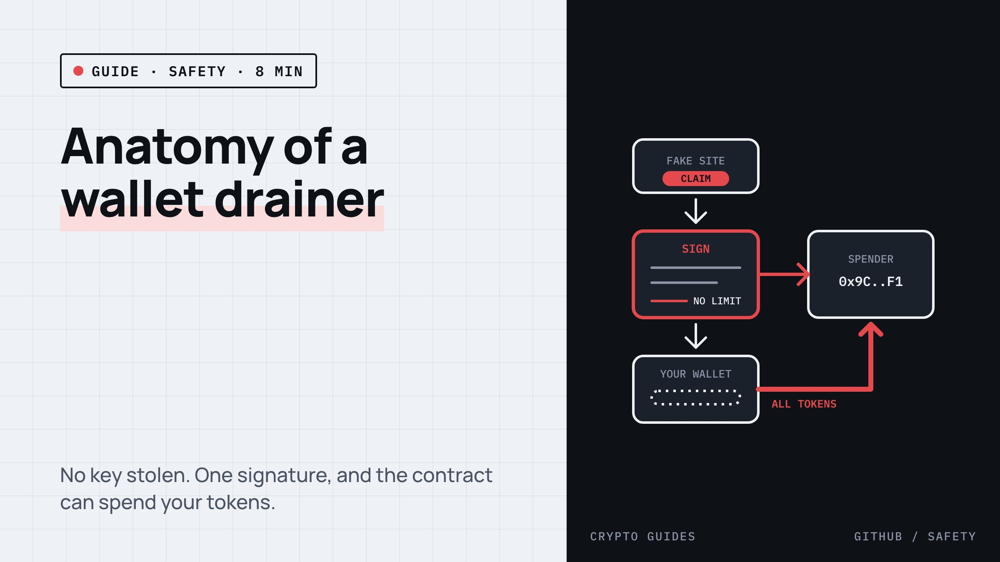
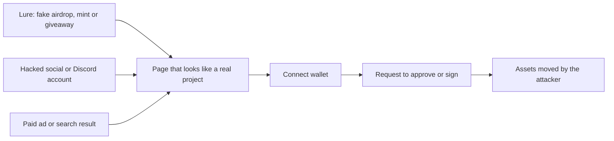
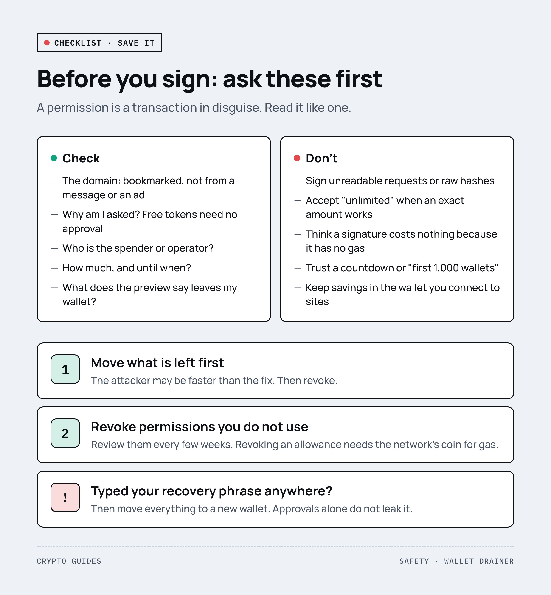

# Anatomy of a wallet drainer: why "it was only a signature" still empties your wallet

**A drainer never needs your recovery phrase. It needs one approval or one signature from you. This is how the funnel works, what gets signed, and how to read a request before you press Confirm.**

This is a defensive guide. It explains the mechanics at the level a user or a wallet developer needs to recognise them, and it contains no attack code and no instructions for building one.

## Contents

- [What a drainer is](#what-a-drainer-is)
- [The funnel: how you end up on the page](#the-funnel-how-you-end-up-on-the-page)
- [What you are asked to sign](#what-you-are-asked-to-sign)
- [Why a signature still loses funds](#why-a-signature-still-loses-funds)
- [Solana: the same idea, different parts](#solana-the-same-idea-different-parts)
- [How to read a request before you sign](#how-to-read-a-request-before-you-sign)
- [Simulation: what it shows and what it hides](#simulation-what-it-shows-and-what-it-hides)
- [Checking and revoking permissions](#checking-and-revoking-permissions)
- [The checklist](#the-checklist)
- [Sources](#sources)

## What a drainer is

A wallet drainer is a website, or a script inside a website, that asks your wallet for a permission and then uses it to move your assets to the attacker. Drainers are usually sold or rented to people who run the scams ("drainer-as-a-service"), and the operator keeps a cut of what is stolen. The page is polished, it connects to a normal wallet, and everything it asks looks like something a real app might ask.

The key point: **the wallet does not break.** Your keys are fine. You gave a permission, and the blockchain honoured it.

## The funnel: how you end up on the page

The signing request is the last step of a longer funnel. Most of the work is getting you to open the page.

- **Fake airdrop or mint.** "Claim your tokens", "mint before it closes". A countdown or "first 1,000 wallets" adds pressure.
- **A compromised account.** A real project's social account or Discord server is taken over and posts a link. The account is real, the link is not.
- **Ads and search results.** A paid ad above the real result, with a near-identical domain name.
- **Direct messages and "support".** A stranger sends a link to "fix" or "verify" your wallet.
- **A compromised front end.** Rarely, the site of a real project is altered so that its normal button asks for a different permission.

The common thread is that **a free thing never needs permission to spend your things.** Claiming an airdrop is receiving tokens. Receiving does not require you to approve anything.

## What you are asked to sign

There are two different things that look alike in a wallet: a **transaction** (sent to the chain, costs gas) and a **signature** (made off-chain, no gas, nothing visible on-chain until someone uses it). Drainers use both.

| Request | What it grants | Why it is dangerous |
|---|---|---|
| `approve(spender, amount)` (ERC-20) | The spender may pull up to `amount` of one token | Often set to 2^256−1, which means "no limit" and does not expire |
| `increaseAllowance(spender, added)` | Adds to an existing allowance | Same effect as `approve`, under a different function name |
| `setApprovalForAll(operator, true)` (ERC-721 / ERC-1155) | The operator may move **every** token of that collection you own | One call covers the whole collection, now and later |
| **EIP-2612 `permit`** (off-chain signature) | The same as `approve`, signed instead of sent | Costs you nothing, leaves no transaction from you, and the attacker submits it when they like |
| **Permit2** signatures | A spender may move tokens through the Permit2 contract, up to an amount and until an expiry | You may have already given Permit2 itself a large allowance for a normal swap, so only the signature is missing |
| **Seaport orders** (NFT marketplace) | A signed order to sell items | A "sale" priced at or near zero is a signature that hands items over |
| Blind signing of a raw hash | Anything at all | The wallet cannot tell you what the hash means |
| EIP-7702 authorisation | Delegates your account to a contract's code | A way to hand your account's behaviour to a contract. Treat any request you did not start yourself as high risk |

Under the hood: what an EIP-2612 permit and a Permit2 signature contain

An EIP-2612 permit is EIP-712 typed data with the fields `owner`, `spender`, `value`, `nonce` and `deadline`. Anyone who holds the signature can call `permit(owner, spender, value, deadline, v, r, s)` on the token. If the signature is valid, the token records an allowance of `value` for `spender`, and the nonce moves forward so the same signature cannot be used twice.

Permit2 is a contract that sits between apps and tokens. You give Permit2 an allowance on a token once. Apps then ask for **signed permits** that tell Permit2 how much a particular spender may move and until when (`amount`, `expiration`, `nonce`, `sigDeadline`). This is convenient and safe when the spender is the app you are using. It is dangerous when the spender is someone else, because the on-chain allowance to Permit2 is already in place.

A decoder for the on-chain forms of these calls is easy to write. The companion gist `decode_calldata.py` shows the selectors (`approve` is `0x095ea7b3`, `setApprovalForAll` is `0xa22cb465`) and highlights unlimited amounts and `operator = true`.

## Why a signature still loses funds

"It was only a signature, I did not send anything" is the most common sentence after a drain. It is wrong in three ways.

1. **A signature is an authorisation.** What you signed is an instruction that someone else can submit later. It has the same power as a transaction you would have sent yourself.
2. **It costs nothing and leaves no trace on your side.** There is no gas for you and no pending transaction. The first on-chain event is the attacker moving your assets.
3. **It does not expire when you close the tab.** Until its deadline (or forever, if the deadline is far away), the signature works. It is only cancelled once its nonce is used or invalidated on-chain (Permit2 has a function for invalidating nonces; a plain EIP-2612 permit does not).

Permissions also outlive the moment. An unlimited `approve` given months ago to a contract that was later replaced or abused is a risk that costs you nothing until the day it does.

## Solana: the same idea, different parts

Solana keeps tokens in token accounts that have an owner and an optional delegate, instead of ERC-20 style allowances inside the token contract. The pattern is still the same: one signature, one transaction, many effects. In general terms, a drainer-style Solana transaction may:

- **Change who controls an account** (for example the owner of a token account), so the assets stay in the account but belong to someone else.
- **Set a delegate** on a token account, which lets another address spend from it.
- **Move all lamports** (SOL) and several token balances in the same transaction.
- **Stay valid for a long time**, if it uses a durable nonce, instead of expiring within roughly a minute or two as an ordinary transaction does.

The wallet shows a simulation, but a transaction can contain many instructions and the preview may summarise them poorly. The reading rules below apply in the same way.

## How to read a request before you sign

Run through these questions. If you cannot answer one, do not sign.

1. **Where am I?** Is this the domain I bookmarked, opened from the official channel? Not a link from a message or an ad.
2. **Why am I being asked?** Did I just do something that needs this (a swap, a mint I chose)? A claim of "free tokens" never needs an approval.
3. **Is it a transaction or a signature?** A signature request with no gas fee deserves more attention, not less.
4. **Who is the spender or operator?** Is it the contract of the app I am using, or an address I have never seen? If the wallet shows a name, check it comes from a known list and not from the site.
5. **How much?** Unlimited is rarely required. Ask for the exact amount if the app allows it.
6. **Until when?** A far-future expiry is the same as none.
7. **What does the preview say will leave my wallet?** If the answer is "nothing" for a request that grants rights, that is the trap.
8. **Is the wallet showing it in readable form?** A wall of hex or "sign this message" with no details is not a request to approve.

## Simulation: what it shows and what it hides

Many wallets and extensions run the transaction on a copy of the chain and show the balance changes. That helps, and you should use it. Its limits are real:

- It shows what **would** happen if the transaction ran now. A contract can behave differently later.
- An off-chain signature has no balance change at all at the moment you sign it. The harm comes when someone submits it.
- It tells you the effect, not whether the **recipient** is the one you meant.

Some wallets, such as Tint Wallet, also put the result in plain words: what leaves the wallet, its value in dollars and what stays. That is easier to check than a list of raw fields, but it is still only one input. So treat the preview as one input, together with the questions above, not as a stamp of approval.

## Checking and revoking permissions

You can list who is allowed to spend your tokens and cancel any permission you do not use. Revoking an ERC-20 allowance is itself a small transaction that needs the network's coin for gas.

- Public tools exist for this on Ethereum-family networks (for example Revoke.cash, or the "token approvals" page of a block explorer).
- Some wallets show it inside the app. Tint Wallet lists which contracts may spend your coins on Ethereum-family networks, and delegates on Solana, with a Revoke button. [tint.top/wallet](https://tint.top/wallet/)
- Revoking removes an on-chain allowance. A signed permit that has not been used yet is a different case: it is cancelled by using or invalidating its nonce, so ask the tool you use how it handles that.
- If a drain is in progress, **moving the remaining assets first** often matters more than revoking, because the attacker may be faster than the fix. If you also typed your recovery phrase anywhere, you must move everything to a new wallet.

## The checklist

- [ ] I open projects from their official site, bookmarked, never from a message or an ad.
- [ ] I treat "free tokens" that ask for an approval as a scam.
- [ ] I keep savings in a wallet that never connects to websites, and use a separate wallet with little in it for new things.
- [ ] Before I sign, I know the spender, the amount and the expiry.
- [ ] I do not sign unreadable requests or raw hashes.
- [ ] I prefer exact amounts over "unlimited".
- [ ] I use a transaction preview and I know it does not cover signatures well.
- [ ] I review my permissions every few weeks and revoke what I do not use.
- [ ] If something goes wrong: move what is left, then revoke, then tell the people the link came from.

## Sources

- [EIP-20: Token Standard](https://eips.ethereum.org/EIPS/eip-20) — `approve`, `transferFrom`, allowances
- [EIP-721](https://eips.ethereum.org/EIPS/eip-721) and [EIP-1155](https://eips.ethereum.org/EIPS/eip-1155) — `setApprovalForAll`
- [EIP-712: Typed structured data signing](https://eips.ethereum.org/EIPS/eip-712)
- [EIP-2612: Permit extension for ERC-20](https://eips.ethereum.org/EIPS/eip-2612)
- [Uniswap Permit2 repository and documentation](https://github.com/Uniswap/permit2)
- [Seaport documentation](https://docs.opensea.io/docs/seaport)
- [EIP-7702: Set code for EOAs](https://eips.ethereum.org/EIPS/eip-7702)
- [Solana docs: Transactions](https://solana.com/docs/core/transactions) and [durable nonces](https://solana.com/developers/guides/advanced/introduction-to-durable-nonces)
- [SPL Token program](https://spl.solana.com/token) — `Approve`, `SetAuthority`
- [Revoke.cash](https://revoke.cash/)

---
Contributions and corrections are welcome — open an issue or a pull request.
License: CC BY 4.0. *Prepared with input from the Tint Wallet team.*
